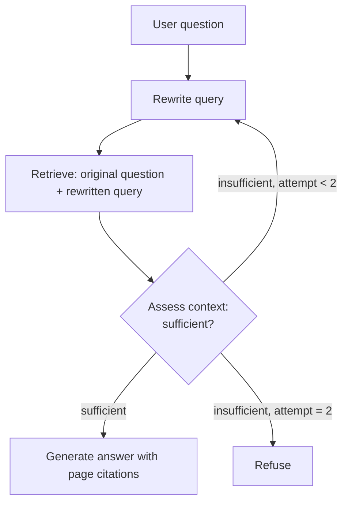
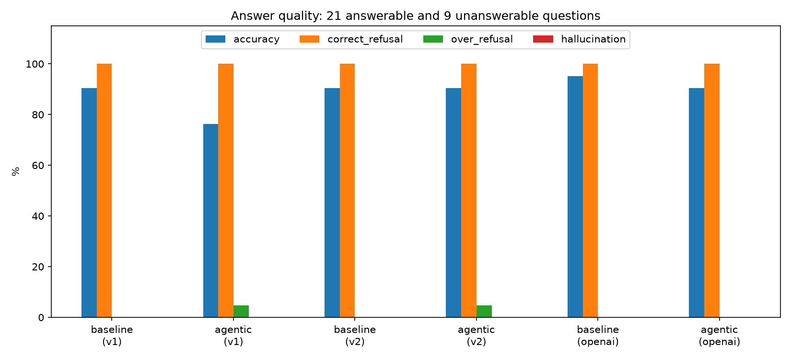
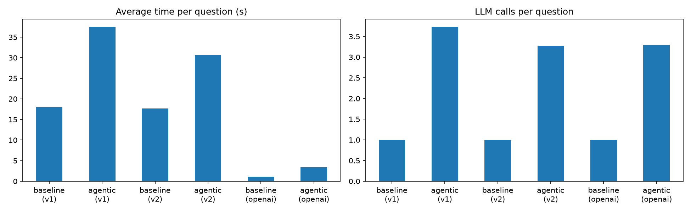

# Agentic RAG with Sufficient-Context Verification

**Does a RAG system become more reliable if it first checks whether the retrieved context is sufficient, and refuses to answer when it is not?**

This project compares two question-answering systems over a technical maintenance guide:

- **Baseline RAG:** retrieve the 5 most relevant chunks, answer in one LLM call.
- **Agentic RAG** (LangGraph): rewrite the query, retrieve, let an LLM judge whether the context is sufficient, retry once with a new query if it is not, then answer with page citations or refuse.

Both systems were evaluated on 30 questions (simple, multi-part, and questions with no answer in the document), with a local model (Ollama) and an API model (OpenAI).

**Main finding:** on this document, the agent was **not more reliable** than the baseline. The baseline, instructed to refuse when the context lacks the answer, already refused all 9 unanswerable questions and never hallucinated. The agent matched the baseline's accuracy only after one retrieval fix (v2), and it was **1.7–3x slower** with **3.3x more LLM calls**. The same pattern appeared with two very different models.

This is a proof of concept, not a production system.

---

## Use case

Maintenance teams, building operators and engineering firms work with long technical manuals. A RAG assistant can answer questions from these documents, but in this setting a confident wrong answer is worse than "I don't know". The agentic design targets exactly that risk: it should answer only when the documents support the answer.

**Documents:** chapters 3–8 (96 pages) of the *Operations & Maintenance Best Practices Guide, Release 3.0* (U.S. Department of Energy, Federal Energy Management Program): O&M management, CMMS, types of maintenance programs, predictive maintenance technologies (thermography, oil analysis, ultrasound, vibration, motor analysis), commissioning of existing buildings, and metering. The PDF is not stored in this repository; `download_docs.py` downloads it from the official source.

Chapter 9 (equipment-specific guidance) was deliberately excluded. This makes it possible to write realistic unanswerable questions: on-topic questions (e.g. boiler tube inspection intervals) whose answers are not in the indexed chapters.

---

## Architecture



| Node | Role |
|---|---|
| Rewrite query | Turns the user question into a search query; on the second attempt it is told what failed. |
| Retrieve | Vector search in Chroma. In v2, results for the original question and the rewritten query are interleaved (top 5 kept, same as the baseline). |
| Assess context | LLM decides `SUFFICIENT` / `INSUFFICIENT` against the **original** question, with a one-sentence reason. Unclear replies count as insufficient. |
| Generate answer | Same prompt as the baseline, so the only difference between the two systems is the verification loop. |
| Refuse | Fixed refusal sentence. |

The "planner" role is implemented as a rule-based conditional edge, not as a separate LLM node.

**Stack**

| Component | Choice | Why |
|---|---|---|
| LLM (local) | `qwen3.5:9b` via Ollama | Free, on-premise, fits a 16 GB MacBook Air M4 |
| LLM (API) | `gpt-5-mini` via OpenAI | Fast; checks that conclusions hold for a different model |
| Embeddings | `bge-m3` via Ollama (1024 dims) | Local and multilingual (English and French) |
| Vector database | Chroma (on disk) | No server needed. Milvus would be the choice for larger corpora |
| Agent orchestration | LangGraph | Explicit graph of nodes and conditional edges |
| Provider independence | `openai` Python client | Ollama exposes an OpenAI-compatible API, so switching provider is one line in `config.py` |

**Ingestion:** text extracted page by page with `pypdf`, split into 1,000-character chunks with 200-character overlap (317 chunks), each tagged with its page number in the official PDF.

---

## Evaluation

**Question set** (`eval_questions.json`): 30 questions with reference answers and pages.

- 12 simple: the answer is in one place.
- 9 compound: the answer combines two places in the document.
- 9 unanswerable: on-topic, but the answer is not in chapters 3–8.

**Grading:** an LLM judge (`gpt-5.4-mini`, a different model from the systems under test) labels each answer `CORRECT`, `INCORRECT` or `REFUSED`, comparing it with the reference answer. Refusals are recognized by meaning, not by an exact sentence.

**Metrics**

- Accuracy: correct answers on the 21 answerable questions.
- Over-refusal: refusals on answerable questions (the cost of being too cautious).
- Correct refusal: refusals on the 9 unanswerable questions.
- Hallucination: invented answers on unanswerable questions.
- Citation accuracy: every cited page must be among the retrieved pages (checked by code).
- Average time per question, LLM calls, tokens.

---

## Results

| Run | System | Accuracy (21) | Correct refusals (9) | Hallucinations | Over-refusals | Time / question | LLM calls |
|---|---|---|---|---|---|---|---|
| Local, run 1 | Baseline | 19 (90%) | 9 (100%) | 0 | 0 | 18.0 s | 1.0 |
| Local, run 1 | Agentic v1 | 16 (76%) | 9 (100%) | 0 | 1 | 37.5 s | 3.7 |
| Local, run 2 | Baseline | 19 (90%) | 9 (100%) | 0 | 0 | 17.7 s | 1.0 |
| Local, run 2 | Agentic v2 | 19 (90%) | 9 (100%) | 0 | 1 | 30.6 s | 3.3 |
| OpenAI | Baseline | 20 (95%) | 9 (100%) | 0 | 0 | 1.1 s | 1.0 |
| OpenAI | Agentic v2 | 19 (90%) | 9 (100%) | 0 | 0 | 3.4 s | 3.3 |




Full metrics: `results/summary.csv`. Every answer, verdict and agent trace (queries tried, assessor's reason): `results/raw_*.json`.

**API cost:** the full OpenAI run (60 answers) cost about $0.01 for the baseline and $0.025 for the agent, at gpt-5-mini prices at the time of writing.

### What happened

**v1: the agent was worse than the baseline.** Error analysis showed three causes:

1. **Query rewriting drifted.** For one question the rewritten query was unrelated to the question ("host, application service, virtual resource, and logical resource"). The baseline, searching with the original question, did not have this problem.
2. **The answer generator contradicted the assessor.** The assessor judged the context sufficient, yet the generator gave correct figures and then appended the refusal sentence.
3. **The second retrieval attempt was sometimes worse than the first.**

The agent's loop also worked as intended at least once: the first search missed one of two technologies, the assessor said "insufficient", and the retry found it.

**v2: one change, chosen from the error analysis.** Retrieval now interleaves results for the original question (anchor) and the rewritten query (exploration). A bad rewrite can no longer push out good chunks. Only retrieval was changed, so the effect can be attributed to it; the generator issue (cause 2) was left as is and still causes the remaining over-refusal. Accuracy rose from 16 to 19 out of 21, equal to the baseline.

The baseline gave the same score with the same errors in both local runs, so the v1 → v2 difference is unlikely to be random noise.

### Why the agent did not help here

Verification helps when the first retrieval misses, or when the model tends to answer from weak context. Neither was common here: one clean, well-structured document, a strong embedding model, and models that follow the instruction "refuse if the context does not contain the answer". In these conditions the extra steps add latency and new failure points (rewriting, assessment, generation) without preventing errors. The agent is more likely to pay off with many similar documents, vague user questions, or weaker models.

---

## Limitations

- **Small test set:** 30 questions, one document. Differences of one or two questions are not statistically meaningful.
- **One run per configuration** (except the local baseline, run twice).
- **LLM judge:** the judge can make mistakes; its verdicts were checked manually only for the disagreements and errors discussed above.
- **Reference answers** were drafted by an AI assistant from the extracted text and spot-checked by me against the PDF. Two issues were found: one reference was incomplete (fixed and re-judged before the v1 results were finalized), and one question (M05, "which two technologies indicate bearing wear") accepts several valid pairs while the reference lists one. Some answers judged incorrect on M05 are actually valid, so accuracy is slightly underestimated for all systems.
- **v2 was designed using errors on the same 30 questions,** so its result may be slightly optimistic. A fresh question set would be needed for a strict test.
- **Text extraction artifacts:** repeated page headers and broken hyphenation from the PDF; chunks do not cross page boundaries; chunk size was not tuned.
- **Timing** was measured on a MacBook Air M4 (16 GB); a warm-up call excludes model loading time.

## Possible improvements

- Pass the assessor's decision to the generator (or use structured output) so they cannot contradict each other.
- Add a planner as a separate LLM node, as in the full agentic RAG pattern.
- Hybrid search (keyword BM25 + vectors) and a reranker.
- A larger, multi-document corpus (French documents included, since `bge-m3` is multilingual) and a new, held-out question set.
- On-premise scaling: Milvus instead of Chroma, vLLM instead of Ollama.

---

## How to run

Requirements: Python 3.12 and [uv](https://docs.astral.sh/uv/), [Ollama](https://ollama.com) running locally, and an OpenAI API key for the judge (and optionally for the OpenAI provider).

```bash
uv sync                                   # install dependencies from pyproject.toml
ollama pull qwen3.5:9b
ollama pull bge-m3
echo "OPENAI_API_KEY=sk-..." > .env       # never commit this file

uv run python download_docs.py            # download the guide, extract chapters 3-8
uv run python ingest.py                   # chunks -> embeddings -> Chroma
uv run python baseline_rag.py "What is infrared thermography used for in maintenance?"
uv run python agentic_rag.py "What is infrared thermography used for in maintenance?"
uv run python evaluate.py                 # both systems x 30 questions, judged
uv run python analysis.py                 # table and plots in results/
```

To use the OpenAI model instead of the local one, set `LLM_PROVIDER = "openai"` in `config.py`.

## Repository structure

```
config.py            all settings: paths, chunking, models, provider switch
download_docs.py     downloads the guide and extracts chapters 3-8
ingest.py            PDF -> chunks -> embeddings -> Chroma
retriever.py         similarity search (used by both systems)
llm.py               one LLM call, for Ollama or OpenAI
baseline_rag.py      baseline RAG
agentic_rag.py       LangGraph agent with sufficient-context verification
eval_questions.json  30 evaluation questions with reference answers
evaluate.py          runs both systems, LLM judge, saves raw results
analysis.py          metrics table and plots
results/             raw results, summary.csv, plots
```

## How this project was built

The code was written with the help of an AI assistant (Claude). My work: defining the research question and scope, choosing the documents and models, running every step locally, testing, reviewing the reference answers, analysing the errors, deciding on the v2 change, and interpreting the results.

## Source and license

Documents: U.S. Department of Energy, FEMP, *Operations & Maintenance Best Practices Guide, Release 3.0*. Downloaded from energy.gov by `download_docs.py`; not redistributed here.

Code: MIT License.
